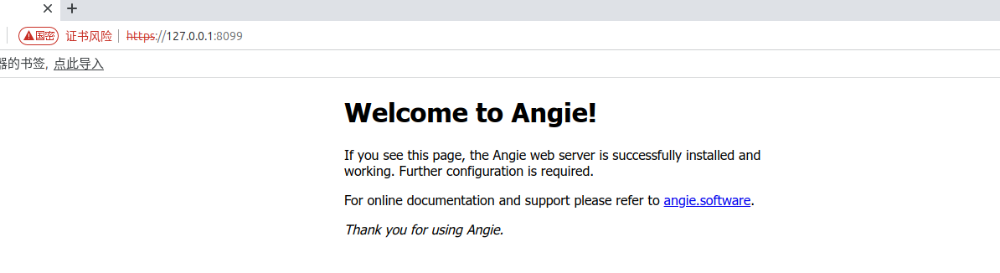
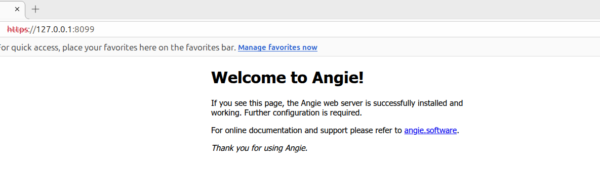

# angie-docker

## 官方镜像名

```shell
# 支持minimal xxx-alpine
docker pull docker.angie.software/angie:1.12.2-alpine
# 官网 https://en.angie.software
```

## 镜像变体

| Dockerfile | SSL 库 | 国密 NTLS | HTTP/3 | 说明 |
|---|---|---|---|---|
| `Dockerfile` | 铜锁 8.5.0 (OpenSSL 3.5) | 支持 | 完整（含 0-RTT） | 国密主力镜像 |
| `Dockerfile-template` | 铜锁 8.5.0 (OpenSSL 3.5) | 支持 | 完整（含 0-RTT） | 同上 + gomplate 模板渲染 |


## 快速开始

1. 构建镜像

* 构建主镜像（极简版：`CMD ["angie","-g","daemon off;"]`，PID1 即 angie master，前台运行）

```shell
docker buildx build -t angie:ntls-alpine -f Dockerfile .
```

* 构建支持 template 的镜像（`/init` 启动 + `ANGIE_*` ENV 渲染 `angie.conf.template`）

```shell
docker buildx build -t angie:ntls-template-alpine -f Dockerfile-template .
```

2. 运行容器

```shell
docker run --rm --name angie-ntls --ulimit nofile=65536:65536 \
  -p 8089:80 -v http.d:/etc/angie/http.d -v stream.d:/etc/angie/stream.d \
  angie:ntls-alpine
```

* 运行 HTTP/3（HTTP/3 走 UDP，**必须**放通 443/udp；铜锁 8.5.0 原生支持 QUIC，主镜像即可）

```shell
docker run --rm --name angie-h3 \
  -p 80:80 -p 443:443 -p 443:443/udp \
  angie:ntls-alpine
```

3. 验证NTLS支持

```text
angie -V
Angie version: Angie/1.12.2
nginx version: nginx/1.31.2
built on Fri, 28 Aug 2026 05:26:45 GMT
built by gcc 14.2.0 (Alpine 14.2.0)
built with OpenSSL 3.5 3 Aug 2026
TLS SNI support enabled
configure arguments: --prefix=/etc/angie --conf-path=/etc/angie/angie.conf --error-log-path=/var/log/angie/error.log 
--http-log-path=/var/log/angie/access.log --lock-path=/run/angie.lock --modules-path=/usr/lib/angie/modules 
--pid-path=/run/angie.pid --sbin-path=/usr/sbin/angie --http-acme-client-path=/var/lib/angie/acme 
--http-client-body-temp-path=/var/cache/angie/client_temp --http-fastcgi-temp-path=/var/cache/angie/fastcgi_temp 
--http-proxy-temp-path=/var/cache/angie/proxy_temp --http-scgi-temp-path=/var/cache/angie/scgi_temp 
--http-uwsgi-temp-path=/var/cache/angie/uwsgi_temp --user=angie --group=angie --with-file-aio --with-http_acme_module 
--with-http_addition_module --with-http_auth_request_module --with-http_dav_module --with-http_flv_module 
--with-http_gunzip_module --with-http_gzip_static_module --with-http_mp4_module --with-http_random_index_module 
--with-http_realip_module --with-http_secure_link_module --with-http_slice_module --with-http_ssl_module 
--with-http_stub_status_module --with-http_sub_module --with-http_v2_module --with-http_v3_module --with-mail 
--with-mail_ssl_module --with-stream --with-stream_acme_module --with-stream_mqtt_preread_module 
--with-stream_rdp_preread_module --with-stream_realip_module --with-stream_ssl_module --with-stream_ssl_preread_module 
--with-threads --with-ld-opt='-Wl,--as-needed,-O1,--sort-common -Wl,-z,pack-relative-relocs' 
--with-openssl=../tongsuo-8.5.0 --with-openssl-opt='enable-ntls enable-ec_elgamal enable-sm2 enable-sm3 enable-sm4 enable-brotli enable-zstd enable-zlib' --with-ntls --add-dynamic-module=../ngx_brotli 
--add-dynamic-module=../headers-more-nginx-module --add-dynamic-module=../echo-nginx-module 
--add-dynamic-module=../ngx_http_substitutions_filter_module --add-dynamic-module=../ngx_cache_purge 
--add-dynamic-module=../nginx-dav-ext-module --add-dynamic-module=../ngx_devel_kit 
--add-dynamic-module=../set-misc-nginx-module
```

## NTLS 站点部署与验证

`http.d/ntls-8099-gm.conf.example` 是一个可直接启用的国密示例站点（8099 端口，NTLS + 标准 TLS 双模式），配套 `http.d/rfc8998-gm.conf.example`（8100 端口，RFC8998 GM TLS1.3 单证书）。启用步骤：

1. **生成证书**：在宿主机建两个证书目录，分别运行 `scripts/mkcert-sm2.sh`（国密双证书 + RFC8998 单证书）和 `scripts/mkcert-rsa.sh`（RSA 证书），CN/SAN 默认 `*.testsm2.selfsign` / `*.testrsa.selfsign` + `localhost` + `127.0.0.1`（改 `scripts/*.sh` 顶部变量区后重新生成）；
2. **挂载并启用**：

```shell
docker run --rm --name angie-ntls \
  -p 8099:8099 -p 8100:8100 \
  -v certs-sm2:/etc/angie/certs/sm2 -v certs-rsa:/etc/angie/certs/rsa \
  -v ntls-8099.conf:/etc/angie/http.d/ntls-8099.conf \
  -v rfc8998-8100.conf:/etc/angie/http.d/rfc8998-8100.conf \
  angie:ntls-alpine
```

   即把两个 `.example` 复制为 `ntls-8099.conf` / `rfc8998-8100.conf` 挂入 `http.d`，证书文件放到 `/etc/angie/certs/sm2` 与 `/etc/angie/certs/rsa`：

   | 文件 | 来源 |
   |---|---|
   | `sm2/hserver_sign-chain.crt` + `hserver_sign.key` | mkcert-sm2.sh（NTLS 签名证书，含链） |
   | `sm2/hserver_enc-chain.crt` + `hserver_enc.key` | mkcert-sm2.sh（NTLS 加密证书，含链） |
   | `sm2/hserver_single-chain.crt` + `hserver_single.key` | mkcert-sm2.sh（RFC8998 单证书，含链） |
   | `rsa/hserver-chain.crt` + `hserver.key` | mkcert-rsa.sh（标准 TLS 证书，含链） |

3. **验证**：
   - 标准 TLS（Chrome/Edge/Firefox/curl，需信任根 CA 或忽略告警）：`curl -vk --resolve www.testrsa.selfsign:8099:127.0.0.1 https://www.testrsa.selfsign:8099/`
   - NTLS 国密：标准 curl 不支持，需用铜锁/国密客户端访问 `https://www.testsm2.selfsign:8099/`（或 `https://localhost:8099/`），；
   - RFC8998：见下方“测试说明”。

> 证书 SAN 默认覆盖 `localhost` / `127.0.0.1` / `*.testsm2.selfsign` / `*.testrsa.selfsign`；浏览器直接访问 `https://localhost:8099` 可验证标准 TLS 路径，国密路径必须用国密客户端。






## HTTP/3 配置参考

铜锁 8.5.0 基于 OpenSSL 3.5，内置 QUIC（RFC9000）与 0-RTT，两个镜像都完整支持 HTTP/3（含 0-RTT）。监听配置：

```nginx
server {
    listen 443 quic reuseport;   # QUIC / UDP，reuseport 配合多 worker
    listen 443 ssl;              # 同时保留 TCP 回退

    ssl_certificate     /etc/angie/certs/rsa/hserver.crt;
    ssl_certificate_key /etc/angie/certs/rsa/hserver.key;

    ssl_protocols TLSv1.3;       # QUIC 强制要求 TLS 1.3
    ssl_early_data on;           # 0-RTT，仅 OpenSSL >= 3.5.1 生效

    http3 on;
    quic_retry on;
    quic_gso on;                 # 网卡支持 GSO 时开启

    location / {
        add_header Alt-Svc 'h3=":443"; ma=86400';   # 告知客户端支持 h3
        root /usr/share/angie/html;
    }
}
```

验证：

```shell
curl -v --http3 https://your-server.example   # 看到 "using HTTP/3" 即成功
```

## 安全说明

- `/status/`（stub_status）与 `/console/`、`/console/api/` 在 `http.d/default.conf` 中均限制为 `allow 127.0.0.1; deny all;`，需要外部访问时请改为实际内网段并配合反向代理认证；
- 建议 HTTPS 站点加 HSTS：`add_header Strict-Transport-Security "max-age=31536000" always;`

## 测试说明

1. **测试环境**：证书 SAN 覆盖 `localhost` / `127.0.0.1` / `*.testsm2.selfsign` / `*.testrsa.selfsign`；宿主机按“NTLS 站点部署与验证”一节挂载证书与示例页面，容器同时暴露 8099（NTLS）与 8100（RFC8998）；
2. **标准 TLS**：`curl -vk https://localhost:8099/` 或 openssl s_client 验证 RSA 证书路径：

```shell
openssl s_client -connect 127.0.0.1:8099 -servername localhost -CAfile root-intermediate-chain.crt
# 期望: subject=CN=localhost 的 RSA 证书, Protocol: TLSv1.3, Cipher: ECDHE-RSA-AES... 等标准套件
```

3. **NTLS 国密（8099）**：
   - 铜锁/国密客户端（国密版 curl、tongsuo s_client、国密浏览器）访问 `https://localhost:8099/`，握手成功且页面显示 NTLSv1.1 + SM2/SM4 国密套件；
   - 同一 vhost 上标准浏览器走 TLS1.3 + RSA 套件，两条路径互不影响；
   - 证书链验证：`tongsuo verify -CAfile http-full-chain.crt hserver_sign.crt`（mkcert-sm2.sh 末尾已自动验证）；
4. **RFC8998 GM TLS1.3（8100）**：
   - 测试需下载 360 安全浏览器并在设置中打开“支持 rfc8998”开关 https://browser.360.net/gc/index.html （标准浏览器不支持 RFC8998 套件，无法访问）；
   - 官方测试站：https://rfc8998.badgmssl.com/ 与 https://rfc8998only.badgmssl.com/ ；
   - 构建的 angie 若已启用 `rfc8998-8100.conf`（由 `rfc8998-gm.conf.example` 复制而来），也可访问 https://127.0.0.1:8100 用来测试，页面会显示实际协商的协议（应为 TLSv1.3）与套件（TLS_SM4_GCM_SM3 / TLS_SM4_CCM_SM3）；
   - openssl 命令行快速确认服务端只协商 RFC8998 套件：

```shell
openssl s_client -connect 127.0.0.1:8100 -tls1_3 -ciphersuites TLS_SM4_GCM_SM3
# 期望: Protocol: TLSv1.3, Cipher: TLS_SM4_GCM_SM3
``` 
